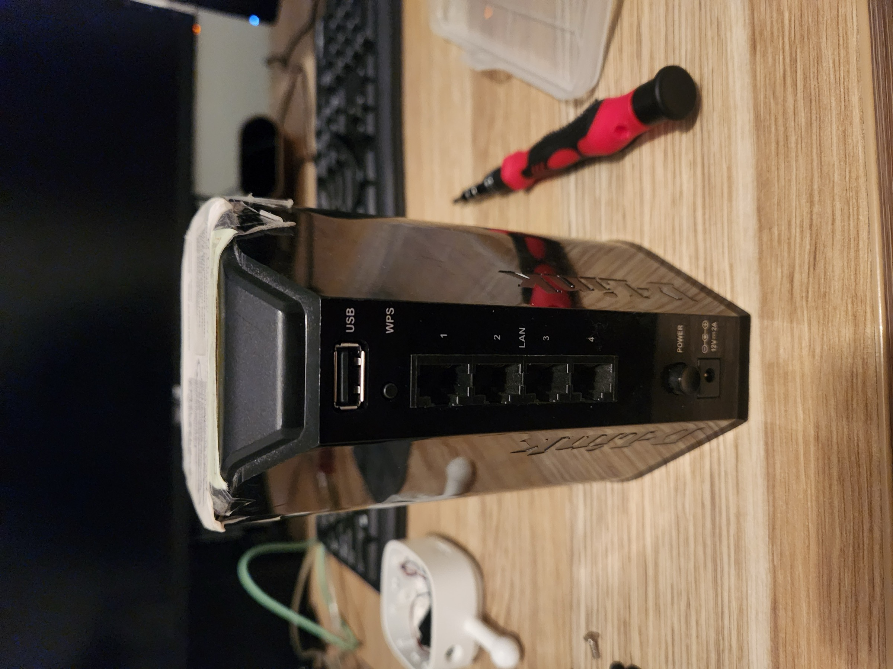
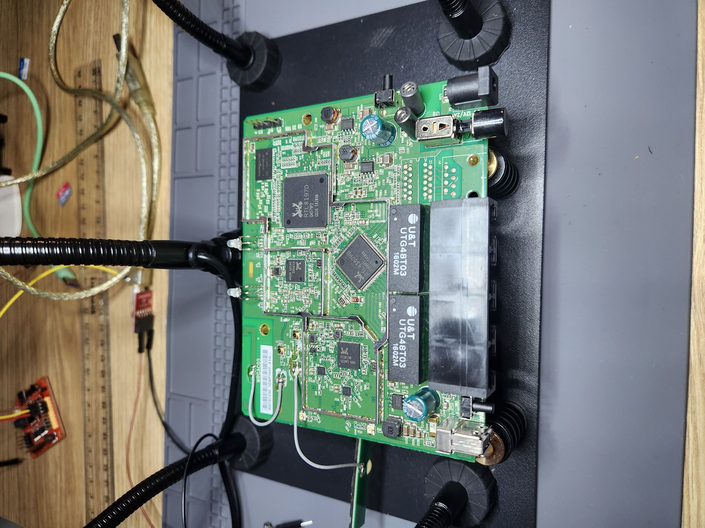
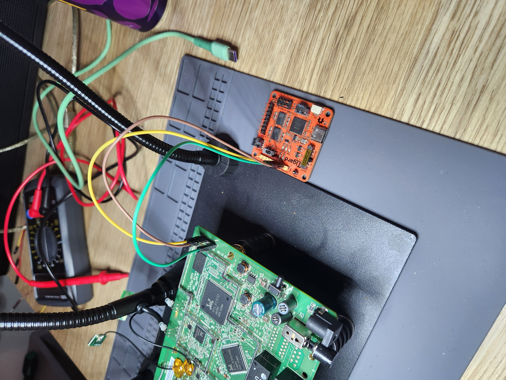
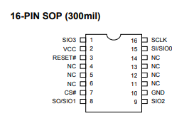
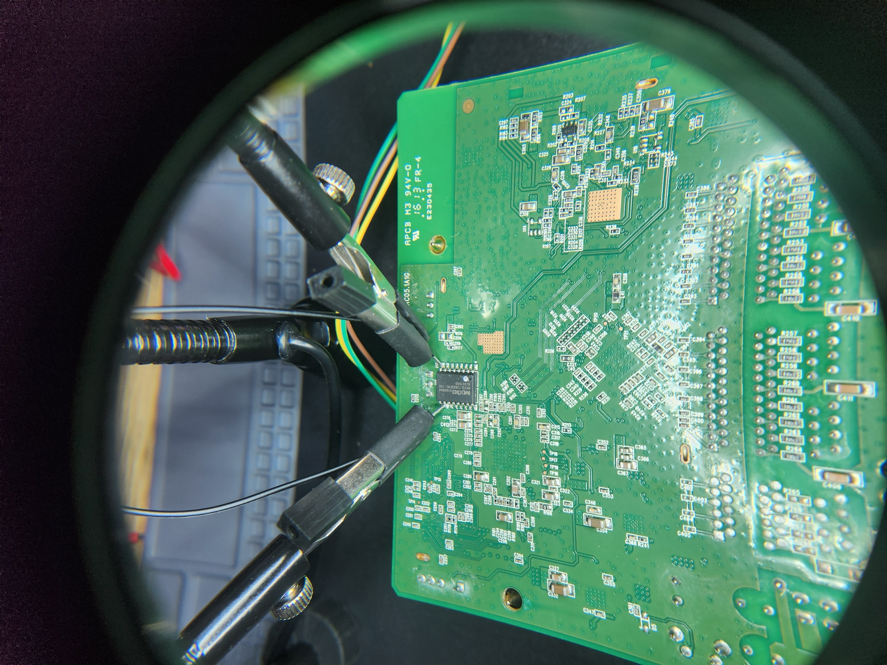

The D-Link DAP-1650 is a fairly basic home router that was released in 2013. With a handful of ethernet ports and a USB port. It's finally been retired and thought it fitting to pull it apart and see what we can find. 



After faffing about with the case for approximately 15 minutes I ripped it off in anger and thankfully didn't break anything. I even kept the Wi-Fi antennae's intact! Now onto looking at the thing.



Fortunately the board is very straight forward layout with the UART pins readily accessible and with jumper pins pre-soldered onto the board, nice. This allows me to just hook a UART capable device up to it and read directly off the board when it's running. For this I used a Tigard board, but any old serial to USB chip will work just fine and costs ~$5. The UART pinout as is follows on the router: 

- Yellow -> TX
- Brown -> GND
- Green -> RX

They are then plugged into the opposites on the Tigard. So, Yellow -> RX, Green -> TX, and GND to GND.


## UART

Connecting to UART pins on the DAP-1650 was very straight forward as it already had pins soldered to the board and gave very clear voltage differences when reading with a multi-meter, which allowed for the correct cables to be hooked up.

Using a program called Picocom, which I interacted with over a WSL USB pass through setup I've configured on my Windows (guide coming soon?? Probably not). With this I can connect directly to the board via the Tigard and begin to read the data straight off the wire. First run the following command to start the Picocom interface (note the funky baud rate):

```
picocom -b 38400 /dev/ttyUSB0
```

And upon turning the router on there are various things printed, with the most interesting being.

```
(...omitted...)

Creating 9 MTD partitions on "flash_bank_1":
0x0000001c0060-0x0000007ea060 : "rootfs"
0x000000050000-0x000000fd0000 : "upgrade"
0x000000040000-0x000000050000 : "retain"
0x000000030000-0x000000040000 : "devconf"
0x000000020000-0x000000030000 : "devdata"
0x000000010000-0x000000020000 : "HW setting"
0x000000fd0000-0x000001000000 : "langpack"
0x000000000000-0x000001000000 : "flash"
0x000000000000-0x000000010000 : "rtlboot"

(...omitted...)

Please press Enter to activate this console.

# ls
www      usr      sys      proc     lib      htdocs   etc      bin
var      tmp      sbin     mnt      include  home     dev
```

So immediately we can see we get dropped into a root shell on the device. No bypasses or anything fancy required. Upon doing some research into the device, I discovered it is used to teach hardware hacking courses to beginners :(.

Now, while we have a root shell, we are still quite limited in what can do with it as the commands we can run are very few. However, given there is a USB port on the board, I reckon we might get up to some funky business and ditch this joint.

However, in the meantime lets dump the firmware using this newly acquired root shell and the USB port. For some reason, when I plugged in a USB stick it triggered the creation of an admin user, which I can now inspect in `/etc/passwd`:

```
# cat /etc/shadow
root:!:10956:0:99999:7:::
nobody:!:10956:0:99999:7:::
Admin:!:10956:0:99999:7:::
```

The configuration files were also located and are where AP keep the wireless password. These live in `/var/run/hostapd-wlan0.conf`:

```
(...omitted...)
wpa_key_mgmt=WPA-PSK
wpa_passphrase=Password123
```

What I found when trying to pull off the source is that the filesystem is read only, which is to be expected, but is problematic as we need to first mount the USB drive to file system. However, since I have root access I can just change the file system permission. First lets inspect the current permissions:

```
# mount | grep " / "
rootfs on / type rootfs (rw)
/dev/root on / type squashfs (ro,relatime)
```

We can see there seem to be to file systems. With one being the SquashFS file system that is read only, we can't change this, but there's another 'virtual' filesystem, presumably used for functionality that needs to write items to disk. Let's change that by remounting the root directory and assigning read AND write permissions:

```
mount -o remount,rw /
```

Now we should be able to create our USB mount point and mount it:

```
mkdir -p /mnt/USBMount
mount /dev/sda1 /mnt/USBMount/
```

If we run the mount command again to list the file systems we see:

```
# mount | grep -E ' / |/mnt'
rootfs on / type rootfs (rw)
/dev/root on / type squashfs (ro,relatime)
/dev/sda1 on /mnt/USBMount type vfat (rw,relatime,fmask=0111,dmask=0000,allow_utime=0022,codepage=cp437,iocharset=utf8,shortname=mixed)
```

With this we can start exfiltrating the entire filesystem. Make sure you use `-L` as it will try to make symlinks otherwise:

```
cp -rL /bin /mnt/USBMount
```

Now unmount the USB:

```
umount /mnt/USBMount
```

We'll look into this further in the [source code analysis](#source-code-analysis) section.
## Glitching

Hooking up a logic analyser lets us look at what the chip is doing during boot and we can see the first thing it tries to do is calculate a checksum (this can be confirmed by the UART output above). Let's see if we can glitch it mid boot and break the boot process. Fortunately, the chip in use (Macronix MC25L 16 pin SOP variant), which is a standard 3.3v chip has long been proven vulnerable to glitching. 



The easiest of which is shorting the GND and SO pin on the chip. Remember, pin 1 will almost always have an indicator dot for determining which way up the chip is. You can just hold a wire there while it's booting if you don't have a little clipping rig. It needs to be reasonably well time as if you attempt to short as you turn the power on the device won't boot. 



I found the easiest way was to wait for the banner to appear before I short the two pins. And Boom! We have another type of shell:

```
Booting...

@@@@@@@@@@@@@@@@@@@@@@@@@@@@@@@@@@@@@@@@@@@@@@@@@@@@@@@@@@@@@@@@@@@@@@@@@@@@@@@@
@
@ chip__no chip__id mfr___id dev___id cap___id size_sft dev_size chipSize
@ 0000000h 0c22018h 00000c2h 0000020h 0000018h 0000000h 0000018h 1000000h
@ blk_size blk__cnt sec_size sec__cnt pageSize page_cnt chip_clk chipName
@ 0010000h 0000100h 0001000h 0001000h 0000100h 0000010h 000002dh MX25L12805D
@
@@@@@@@@@@@@@@@@@@@@@@@@@@@@@@@@@@@@@@@@@@@@@@@@@@@@@@@@@@@@@@@@@@@@@@@@@@@@@@@@

#### Start the short here ####

---RealTek(RTL8196D)at 2013.07.05-14:42+0800 v0.5 [16bit](659MHz)
SVN:884 signature=wapac04_dlob_dap1650
Verifying Checksum ...

Bad Header Checksum.
P0phymode=03, embedded phy

---Ethernet init Okay!
<RealTek>
```

This shell gives us bootloader access and a lower level shell on the device with some interesting functionality, which mostly seems to be memory manipulation commands:

```
<RealTek>?
----------------- COMMAND MODE HELP ------------------
HELP (?)                                    : Print this help message
DB <Address> <Len>
DW <Address> <Len>
EB <Address> <Value1> <Value2>...
EW <Address> <Value1> <Value2>...
CMP: CMP <dst><src><length>
IPCONFIG:<TargetAddress>
AUTOBURN: 0/1
LOADADDR: <Load Address>
J: Jump to <TargetAddress>
SIG: SIG <type><sig>
SIGR: Display signature and flag
FLR: FLR <dst><src><length>
FLW <dst_ROM_offset><src_RAM_addr><length_Byte> <SPI cnt#>: Write offset-data to SPI from RAM
MDIOR:  MDIOR <phyid> <reg>
MDIOW:  MDIOW <phyid> <reg> <data>
PHYR: PHYR <PHYID><reg>
PHYW: PHYW <PHYID><reg><data>
PORT1: port 1 patch for FT2
D8 <Address>
E8 <Address> <Value>
```

I didn't spend too much time in here, but shocking how easy it is to force the kernel into a panicked state.
## Source Code Analysis

The bulk of the router source code is written in PHP which not atypical of a device of this age. I also discovered various `.asp` and `.h` header files , so can only assume there are PHP, .NET, and C binaries on the device that manage functionality. 

The file system contains your standard Linux OS with areas of interest being `/var/run`, this folder contains configuration files, `/var/serd`, which contains all the startup bash scripts, and `/etc/templates/hnap`, which contains all the 'proprietary' PHP source code that is the management panel. Go nuts and if you find anything else interesting let me know!

I'm not going to go through all the source code here, but it does include some interesting relics of the time and contains some juicy known CVE's that allowed a user on the network to get remote code execution on the router. I neither had the time nor the interest to pursue this, but know versions before `v1.03b07` are probably vulnerable to CVE-2015-2051, do with that as you will.
