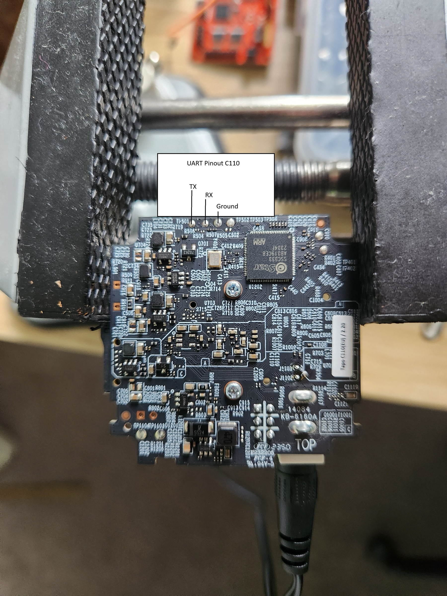
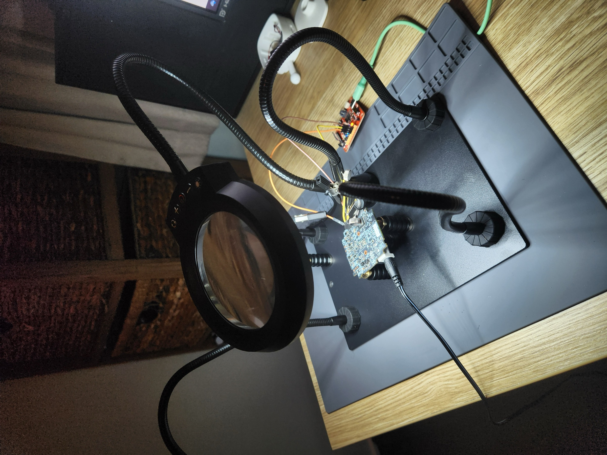
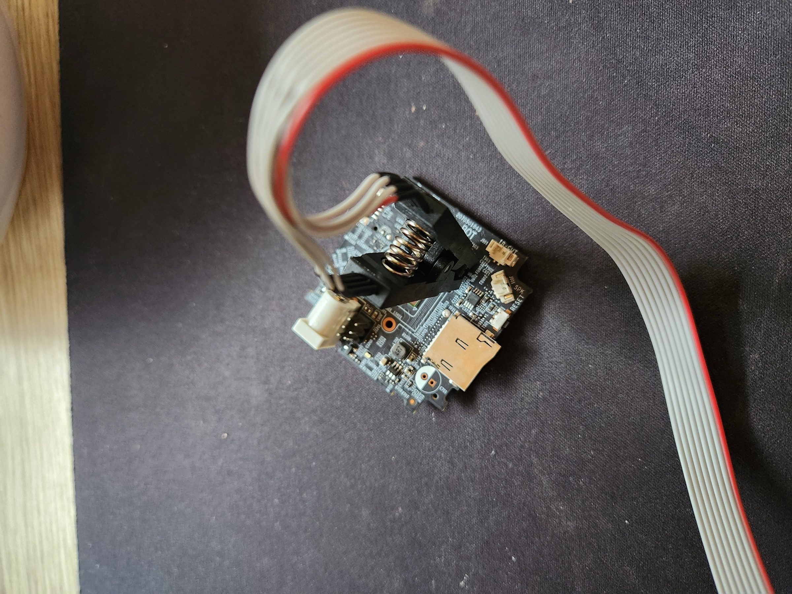
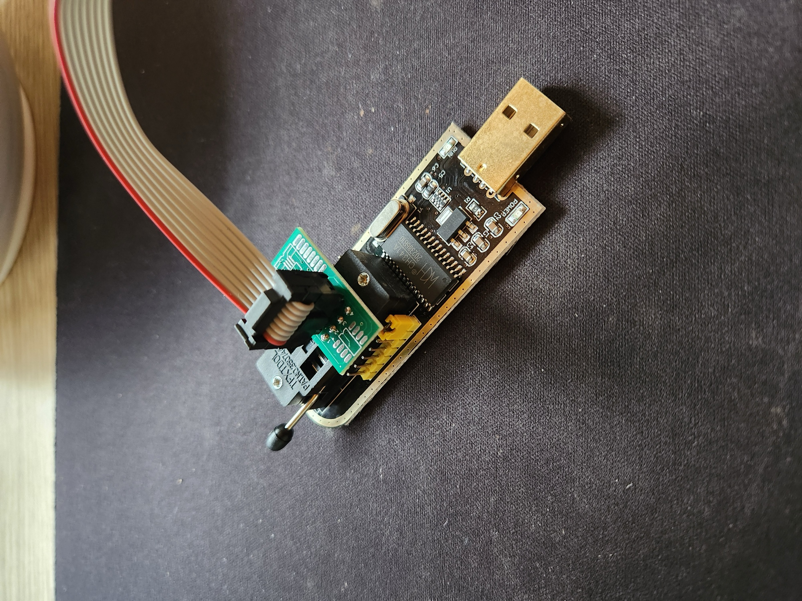
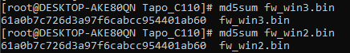
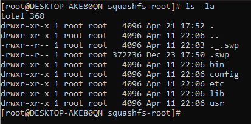
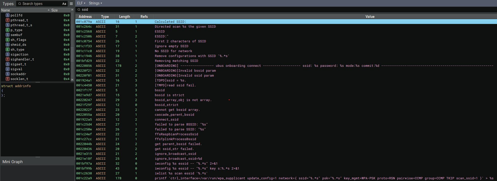

The Tapo C110 camera is a fairly common consumer grade smart camera that lets you set it up in your home, connect it via wifi, and lets you connect remotely. What secrets can be found within? Lets take a look. Note that This is a pretty half baked writeup and I did it over about 3 months and also blew up my first board so had to buy another one. Don't expect any crazy discoveries here.
## Reconnaissance

Once the device is configured and connected to the Internet, I am curious to see what sort of network traffic and ports it presents. First is a port scan using nmap.
##### Port Scan

Running NMAP reveals a handful of open ports, none of which immediately pique my interest:

```
nmap.exe -sCV -vvv -Pn -p- 192.168.0.174
```
##### Wireshark

MAC address is 24-2F-D0-30-89-AC

eth.addr == 24:2F:D0:30:89:AC
## Firmware Extraction - UART

The board does have UART ports, but it seems I ripped the TX pad off when trying to solder a lead on. Will update when I either fix it or find another board. Okay I blew it up. Anyway, I bought another one.

Anyway, below is an annotated screenshot of what each of the pads is for any keen beans who wants to go get themselves a camera and pull it apart.   



However, upon further inspection it seems the UART port has been disabled at the software level as I couldn't spot any missing resistors on the board, which is a common, cheap technique used to disable UART. This was confirmed using two separate FTDI UART chips and two different devices at all common baud rates, nothing.


## Firmware extraction - CH341A

Attach the SOIC8 clip to the chip, making sure the clip is oriented such that the red wire is attached to the corner of the chip with the small hole. This denotes PIN 1 on the chip.



The CH341A reader is a little finicky and I had to order another to as my first one was not functional. Orientate the plug adapter such that the, if the male USB plug is pointing towards you, PIN 1 is facing away from you on the left hand side, see below. Connect the end of the clip cable to the pins sticking up from the adapter with the red wire connected to PIN 1. see photo



As I'm using a Mac, I decided to use `flashrom`, which is a CLI tool to interacting with the reader. Install using `brew install flashrom`. Attach the reader to your laptop and make sure it is detected. Then run the command:

```
flashrom --programmer ch341a_spi --progress -r fw1.bin
```

I'm going to do this twice to make sure the reader is accurately extracting the data and then generate an MD5 hash for each file. They should be the same. 



Now we can pump them into `binwalk`, which is a binary extraction tool. I am using the latest version (Binwalk 3.1.0). First run the command:

```
binwalk fw1.bin 
```

to get a basic understanding of what the file contains and we can see the binary contains two Kernel objects, a whole lot of compressed data, and the most interesting section, a SquashFS file system, bingo. SquashFS is a read-only file system that is very popular on embedded systems.

```
------------------------------------------------------------------------------------------------------------------------------------------
DECIMAL                            HEXADECIMAL                        DESCRIPTION
------------------------------------------------------------------------------------------------------------------------------------------
35932                              0x8C5C                             CRC32 polynomial table, little endian
65536                              0x10000                            uImage firmware image, header size: 64 bytes, data size: 67176
                                                                      bytes, compression: lzma, CPU: ARM, OS: Firmware, image type: OS
                                                                      Kernel Image, load address: 0x0, entry point: 0x0, creation time:

(...Omitted...)

compressed data, operating system: Unix, timestamp: 2024-09-19
                                                                      11:27:25, total size: 27198 bytes
393216                             0x60000                            uImage firmware image, header size: 64 bytes, data size: 62216
                                                                      bytes, compression: lzma, CPU: ARM, OS: Firmware, image type: OS
                                                                      Kernel Image, load address: 0x0, entry point: 0x0, creation time:
                                                                      1970-01-01 00:00:00, image name: ""
524800                             0x80200                            uImage firmware image, header size: 64 bytes, data size: 1445288
                                                                      bytes, compression: none, CPU: ARM, OS: Linux, image type: OS
                                                                      Kernel Image, load address: 0x20008000, entry point: 0x20008000,
                                                                      creation time: 2024-09-19 11:27:13, image name: "Linux-4.9.84"                           
4456448                            0x440000                           SquashFS file system, little endian, version: 4.0, compression: xz,
                                                                      inode count: 104, block size: 65536, image size: 2997144 bytes,
                                                                      created: 2024-09-19 11:27:24
```

Extract the firmware using Binwalk's extract function and watch that baby go:

```
binwalk -e fw.bin
``` 

which leaves us with a `_fw1.bin.extracted` folder and within contains ~15 different folders, with the `./squashfs-root` directory containing the actual contents of the Linux filesystem. 



After some digging I find some interesting binaries, most notably `/squashfs/bin/main` and `/squashfs/config/config_tool`. With the `main` binary presumably being the main application. Lets have a look and see what we can find.
## Source Code Analysis

The main `/squshfs` folder contains some interesting binaries for us to pull apart and look at, most notably:

- /squashfs/main
- /squashfs/config/config_tool
- /squashfs/lib/audio/load_isp_data 

All three of these were loaded into a binary extraction tool, I use BinaryNinja, and interrogated in order to understand what is happening under the hood.
##### Binary - Main

What I was most curious about this camera is what it actually did with my data. How does it store it, how does it communicate with the cloud servers, does it send any of my network information back? Let's find out. First, let's load the binary into BinaryNinja.



After loading the binary, the first thing I looked for were any external URL's that lead me back to the cloud servers the backend services are running on and I quickly located two main ones that caught my eye:

- n-tss.tplinkcloud.com.cn
- device-cloudgateway.iot.i.tplinknbu.com

These just gave me a rough idea of who the camera is talking to and where. It might also be useful for a domain block list if that interests you and will also effectively brick your camera.

Next thing was getting a general understanding of what exactly the device does on boot, and my rough reconstruction seems to be as follows:

During this process I discovered quite a few interesting things that, for the most part, answer my questions above with the biggest being 'does the camera send network information to the cloud?'. Yes, the answer is yes - there are multiple POST requests to the external API endpoint `/api/v1/postWifiScanData` and seems to store this data for later use either by the user or in the event the camera is disconnected and relocated. It attempts to pull down the stored credentials from cloud storage and attempt to authenticate to nearby AP's. It also appears to log the cleartext wi-fi password in multiple locations within the file system. Some getting removed upon a successful mount, and others written to log files.

Found RTSP endpoint. Is it protected? (/cet/rtsp)

```
      if ((iVar1 == 0) || (iVar1 = FUN_000ead00("/cet/rtsp",local_30,2), iVar1 == 0)) {
        msg_debug(0,0xb,3,"soap_tds_get_network_proto_handle",0xcd0,
                  "[ONVIF]ds read %s or %s fail.\n","/uhttpd/main","/cet/rtsp");
      }
```

Kerberos authentication enabled?

```
      iVar1 = FUN_0007cfd0(param_1,"tt:KerberosToken",0,0);
      if (iVar1 != 0) {
        uVar5 = 0x451;
        pcVar4 = 
        "soap_element_bool_type(xml_buf, \"tt:KerberosToken\", g_tds_security_cap.kerberos_token, NU LL)"
        ;
        goto LAB_00085634;
      }
```

Camera reads `.pem` file into memory. 

```
    DAT_002b5fd8 = FUN_000e4550(acStack_98,*(undefined2 *)(g_httpExecuteCallbackData._4_4_ + 8),1,
                                "/etc/data/dss_certificates/StarfieldClass2CertificationAuthority.pe m"
                                ,0x94ddd,0x95215,0x9509d,&g_httpClientCallbackData);
```

After loading certificates, it seems to run the command `exec sh -c '%s'`, a prime target for command injection.

I've left it here for now as I got bored.
### Conclusion

While this wasn't a particularly interesting blog post, I intend to at least keep a record of what I get up to for not only myself, but for others who might be interested. Have any other thoughts? Let me know!
